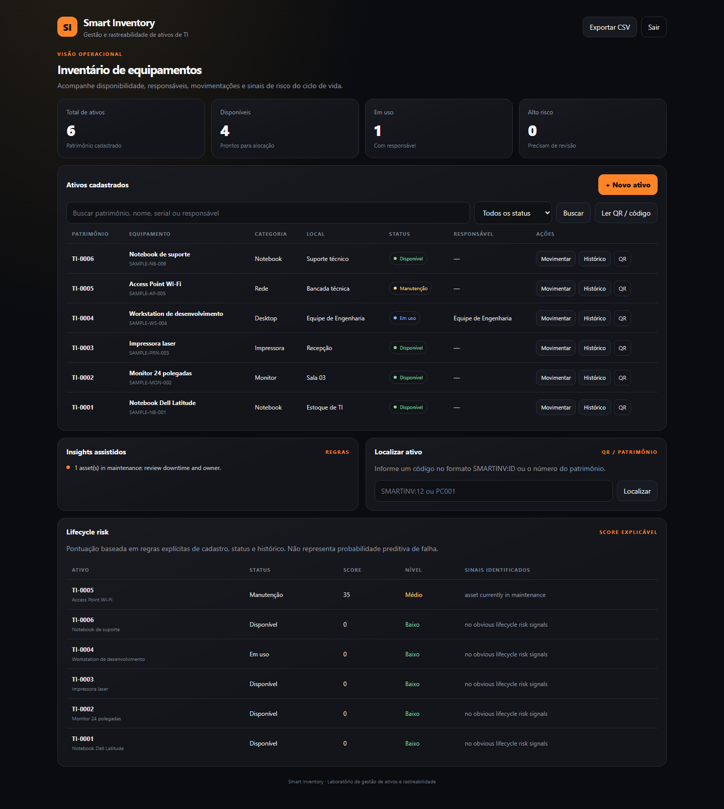

# Smart Inventory

Gestão de ativos de TI com rastreabilidade de movimentações, QR Code e análise explicável de risco operacional.

## Visão geral

O Smart Inventory centraliza o ciclo de vida de equipamentos: cadastro patrimonial, localização, responsável, movimentações, histórico e exportação. A aplicação usa FastAPI e SQLAlchemy, com SQLite no desenvolvimento e PostgreSQL via DATABASE_URL.

## Demonstração

A captura usa seis ativos inteiramente fictícios e demonstra estados disponíveis, em uso e manutenção.

## Funcionalidades

- Cadastro, pesquisa e filtragem de equipamentos.
- Histórico auditável de saída, entrada, transferência, manutenção e baixa.
- Regras de transição: não permite saída de equipamento indisponível, entrada de equipamento que não está em uso ou movimentação de ativo baixado.
- Alterações de status e responsável precisam passar pelo endpoint de movimentações.
- QR Code individual e leitor por câmera quando o navegador oferece BarcodeDetector.
- Dashboard, exportação CSV e insights operacionais.
- Lifecycle Risk com regras explícitas e motivos por ativo.
- Token de demonstração via header X-App-Token.

## Stack

- Python 3.12+
- FastAPI e Pydantic
- SQLAlchemy
- SQLite / PostgreSQL
- Docker e Docker Compose
- pytest e TestClient

## Executar localmente

Windows PowerShell:

~~~powershell
python -m venv .venv
.venv\Scripts\Activate.ps1
pip install -r requirements.txt
$env:APP_TOKEN = "local-demo-token"
uvicorn app:app --reload
~~~

Abra http://127.0.0.1:8000. O token informado no terminal deve ser usado na tela de login.

## Docker Compose

Copie .env.example para .env, substitua os valores de demonstração e execute:

~~~bash
docker compose up --build
~~~

O serviço web fica em http://localhost:8000. Não use os valores ilustrativos do arquivo .env.example em ambientes públicos.

## Testes

~~~bash
python -m pytest -q
python -m compileall -q .
~~~

Os testes cobrem autenticação por token, ciclo de movimentação, consistência do histórico, validação de transferência e bloqueio de alteração de status fora do fluxo auditável.

## API principal

| Método | Rota | Objetivo |
|---|---|---|
| GET | /health | Estado da aplicação |
| GET | /dashboard | Indicadores e movimentações recentes |
| GET | /assets | Pesquisa e filtros |
| POST | /assets | Cadastro |
| GET | /assets/{id} | Detalhes |
| PUT | /assets/{id} | Atualização de metadados |
| POST | /assets/{id}/movements | Registrar movimentação |
| GET | /assets/{id}/movements | Histórico |
| GET | /assets/{id}/qr | QR Code |
| GET | /risk | Score por ativo |
| GET | /insights | Alertas baseados em regras |
| GET | /export.csv | Exportação |

As rotas de dados exigem o header X-App-Token. O endpoint de QR Code gera somente um identificador técnico e não substitui a autenticação da API.

## Segurança e limitações

O token simples é adequado apenas para laboratório. Uma implantação real precisa de autenticação corporativa, RBAC, rotação de segredos, trilha de auditoria protegida, migrações versionadas e controles de acesso por organização.

O score de risco é determinístico e baseado em regras. Não representa probabilidade estatística de falha. A leitura de QR pela câmera depende do suporte do navegador e de contexto seguro (HTTPS ou localhost).

Todos os dados usados em demonstrações devem ser fictícios.
