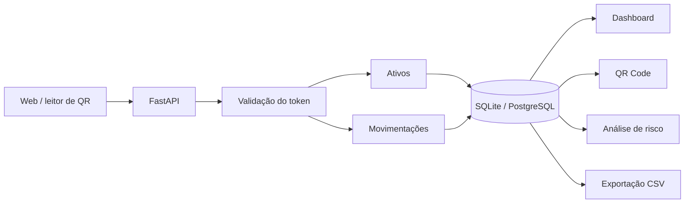

# Arquitetura

O fluxo principal é simples: cadastrar o ativo, registrar cada movimentação e manter um histórico que possa ser consultado depois.

## Dados

`Asset` guarda patrimônio, serial, categoria, local, status e responsável.

`Movement` registra entrada, saída, transferência, manutenção e baixa. A ideia é não perder o histórico quando um equipamento muda de lugar ou de responsável.

## Autenticação

Hoje o projeto usa `APP_TOKEN` porque é suficiente para rodar o laboratório. Em uso real isso teria que ser substituído por autenticação de usuário, permissões e auditoria.

O caminho que quero explorar depois é registrar a movimentação direto pela leitura de QR Code ou código de barras.
