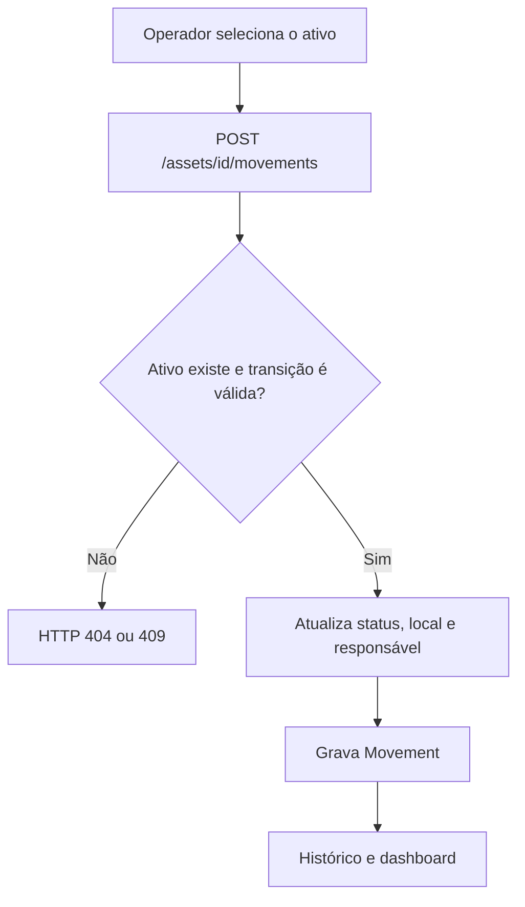

# Organização do Smart Inventory

A regra que orienta o desenho é simples: **mudança de estado precisa deixar um registro**.

## Caminho de uma movimentação

## Estrutura dos dados

- `Asset`: identificação patrimonial, nome, categoria, número de série, local, status e responsável atual.
- `Movement`: ativo relacionado, operação, operador, destino, responsável resultante, observação e data.

A tabela de movimentações é o histórico operacional. O registro do ativo guarda a situação atual para facilitar consultas e filtros.

## Regras de transição

| Operação | Estado exigido | Efeito |
|---|---|---|
| Saída | Disponível | Passa para em uso e recebe responsável |
| Entrada | Em uso | Volta para disponível e limpa o responsável |
| Transferência | Não baixado | Atualiza a localização |
| Manutenção | Não baixado | Passa para manutenção |
| Baixa | Não baixado | Passa para baixado |

Ativos baixados não podem ser movimentados. A edição de metadados também rejeita mudanças diretas de status ou responsável.

## Persistência e autenticação

SQLite é o padrão local; PostgreSQL pode ser selecionado por `DATABASE_URL`. O acesso às rotas de dados usa o header `X-App-Token`, comparado em tempo constante. É uma proteção suficiente para o ambiente de laboratório, não um sistema de identidade corporativa.

O projeto ainda não implementa migrações versionadas, controle de concorrência entre operadores ou separação de dados por organização.
