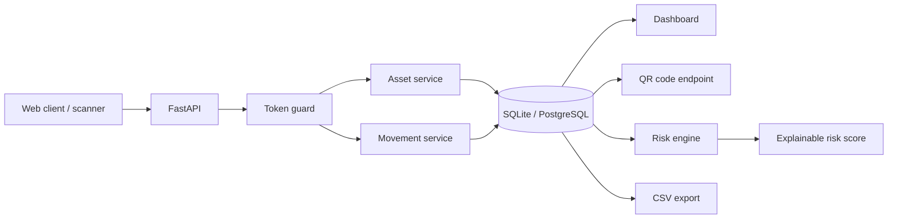

# Architecture

## Goal

Smart Inventory tracks the lifecycle of IT assets, their movements and operational risk using an auditable rule-based score.

## Flow

## Domain model

An `Asset` stores identity, category, location, status and assignment. A `Movement` creates an auditable event trail for check-out, check-in, transfers, maintenance and retirement.

## Security boundary

The current `APP_TOKEN` mechanism is intentionally simple for portfolio use. Production use should replace it with SSO/OIDC, RBAC, audit logs, secret management and scoped service identities.

## Evolution path

The natural next step is event-driven inventory processing: QR/barcode scan -> movement event -> validation -> persisted history -> anomaly/risk analysis.
